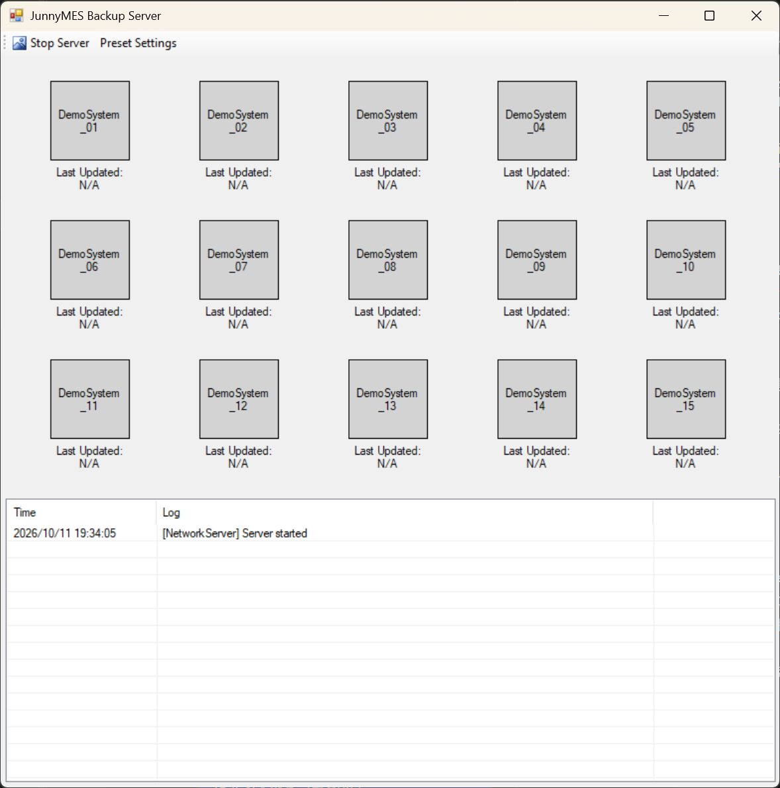
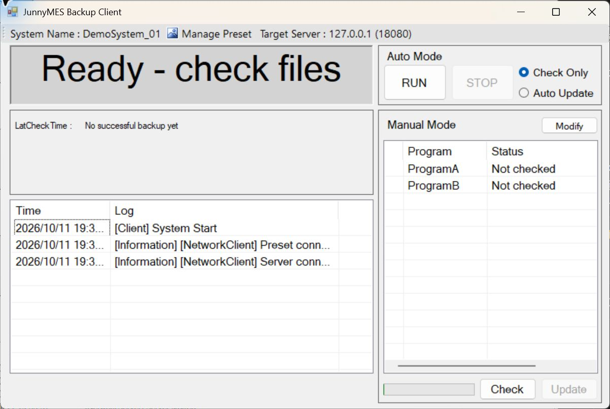
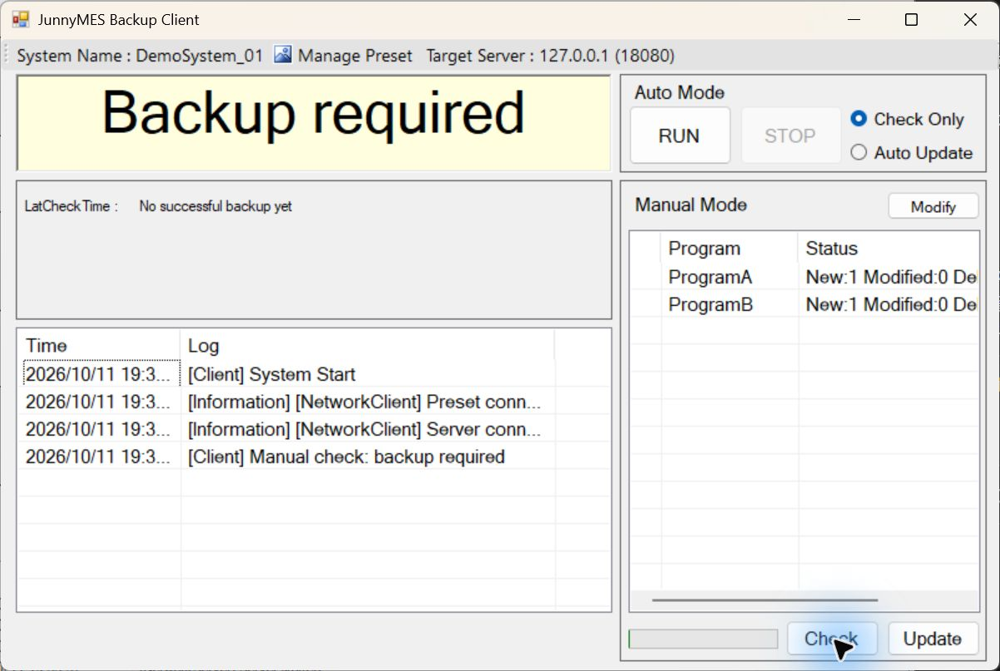
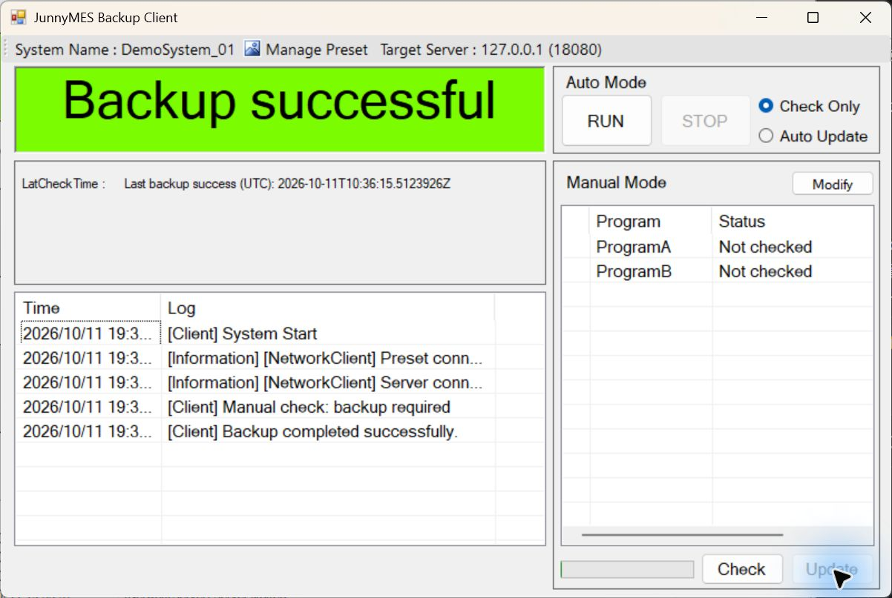
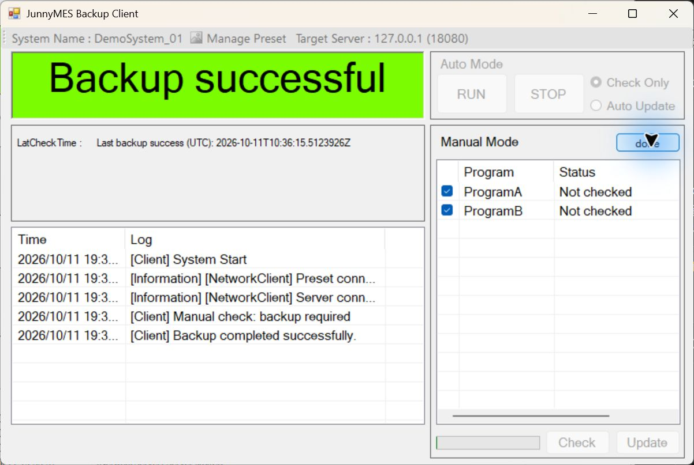
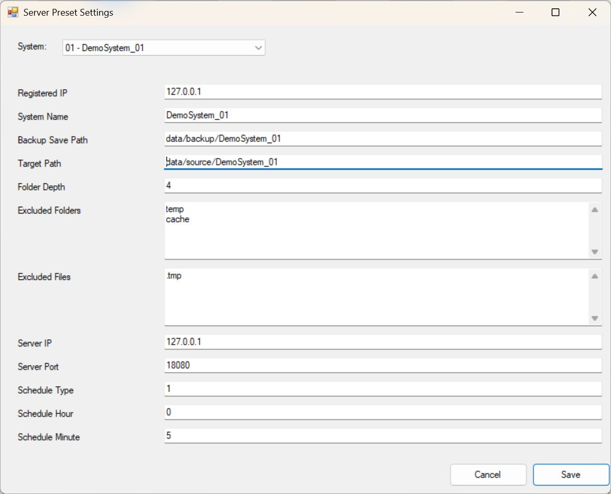
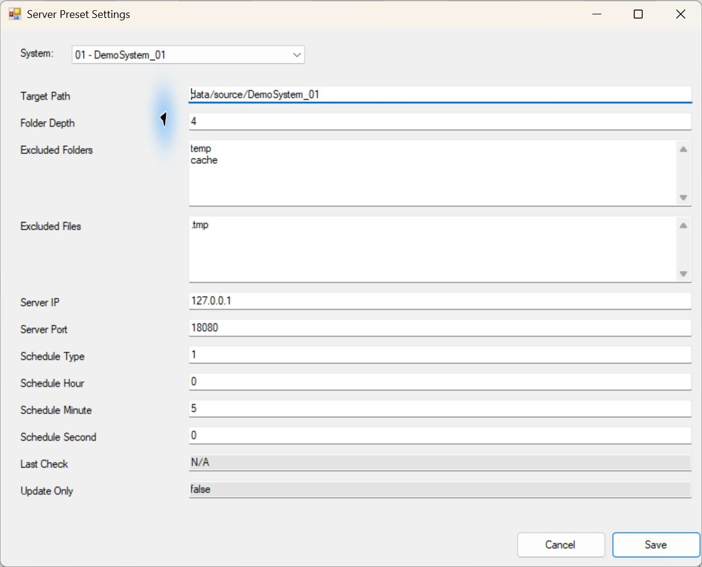

# JunnyMESBackup 사용자 매뉴얼

IPC의 설정·레시피 파일을 검사하고 서버에 백업하는 과정과 프리셋 설정 방법을 설명합니다. 기본 구성은 같은 PC의 `127.0.0.1:18080`에서 실행하는 데모입니다.

[프로젝트 구조와 개요](README.md)

## 목차

1. [실행 준비](#1-실행-준비)
2. [서버 화면](#2-서버-화면)
3. [클라이언트 화면](#3-클라이언트-화면)
4. [첫 백업](#4-첫-백업)
5. [백업 대상 선택](#5-백업-대상-선택)
6. [프리셋 매니저](#6-프리셋-매니저)
7. [예약 실행](#7-예약-실행)
8. [파일 변경과 삭제](#8-파일-변경과-삭제)
9. [실패 후 재시도](#9-실패-후-재시도)
10. [보관 파일과 복원](#10-보관-파일과-복원)
11. [문제 해결](#11-문제-해결)

화면의 날짜·시각은 실행 시점에 따라 달라집니다. 프리셋 경로 예시는 상대경로로 입력한 모습이며, 설정을 다시 열면 같은 위치가 절대경로로 표시될 수 있습니다. 파일·폴더 경로는 별도 언급이 없으면 `JunnyMESBackup.sln`이 있는 소스 루트를 기준으로 합니다.

## 1. 실행 준비

### 1.1 빌드

Windows에 Visual Studio 2022의 **.NET 데스크톱 개발**과 **.NET Framework 4.8 Targeting Pack**을 설치합니다. `JunnyMESBackup.sln`을 열고 **Release / Any CPU → 솔루션 빌드**를 실행합니다.

| 프로그램 | 실행 파일 |
|---|---|
| 서버 | IPC_Backup_Server/bin/Release/IPC_Backup_Server.exe |
| 클라이언트 | IPC_Backup/bin/Release/IPC_Backup.exe |

EXE만 분리하지 말고 DLL이 있는 빌드 폴더와 소스 루트 구조를 유지합니다. VS Code는 소스 편집·Git 관리에 사용할 수 있고, 빌드는 Visual Studio 또는 해당 MSBuild로 수행합니다.

### 1.2 설정·샘플 복사

1. 소스 루트에 `data/config`, `data/source`, `data/backup` 폴더를 만듭니다.
2. `config/client.example.json`을 `data/config/client.json`으로 복사합니다.
3. `config/server.example.json`을 `data/config/server.json`으로 복사합니다.
4. `samples/DemoSystem_01`을 폴더째 `data/source` 아래로 복사합니다.

```text
data/
  config/
    client.json
    server.json
  source/
    DemoSystem_01/
      ProgramA/
        settings.ini
      ProgramB/
        recipe.csv
  backup/
```

기존 `data`가 있다면 현재 설정·백업이 들어 있을 수 있으므로 바로 덮어쓰지 않습니다. `config`는 공개 예제이고 `data/config`는 실제 실행 설정입니다. 실행 중 설정은 앱 화면에서 편집합니다.

### 1.3 시작 순서

**서버 실행 → 서버 시작 확인 → 클라이언트 실행 → 연결 확인 → Check → Update** 순서로 사용합니다. 서버 없이 클라이언트를 먼저 실행했다면 서버 시작 후 **Try reconnect**로 연결합니다.

예제는 DemoSystem_01의 ProgramA·ProgramB를 백업합니다. 나머지 시스템 항목에는 원본 파일이 자동으로 채워지지 않습니다.

## 2. 서버 화면



| 영역 | 역할 |
|---|---|
| Start Server / Stop Server | 파일 수신 서버 시작·중지 |
| Preset Settings | 서버 프리셋 편집 창 열기 |
| DemoSystem 버튼 | 등록 시스템 표시, 클릭하면 해당 백업 폴더 열기 |
| Last Updated | 서버에 기록된 해당 시스템의 마지막 완료 시각 |
| Time / Log | 시작·중지·수신 완료·실패 로그 |

정상 시작 후에는 **Stop Server**가 표시되고 로그에 `Server started`가 남습니다. 시작하지 못했다면 포트 충돌과 로그를 확인합니다.

| 시스템 버튼 색 | 표시 의미 |
|---|---|
| 회색 | 완료 시각이 N/A인 항목 |
| 초록 | 기록된 완료 시각으로부터 7일 미만 |
| 노랑 | 기록된 완료 시각으로부터 7일 이상 |
| 빨강 | 완료 시각 값을 해석할 수 없음 |

이 색은 기록 시각에 따른 표시이며 실시간 설비 연결 상태를 뜻하지 않습니다. 기본 15개 항목 역시 실제 설비 15대의 연결을 의미하지 않습니다. 백업 폴더는 파일 수신 시 만들어지므로 첫 백업 이전에는 폴더가 없을 수 있습니다.

## 3. 클라이언트 화면



| 영역 | 의미·동작 |
|---|---|
| System Name | 연결된 클라이언트의 등록 시스템 이름 |
| Manage Preset | 해당 시스템의 검사 설정·제외 목록 편집 |
| Target Server | 연결할 서버 주소·포트; 연결 설정 진입 |
| 큰 상태 표시 | 준비·변경 발견·완료·실패 상태 |
| LatCheckTime 아래 값 | 마지막으로 성공한 백업 시각; 최초 실행은 No successful backup yet |
| Auto Mode | 검사 전용 또는 자동 백업 예약 |
| Manual Mode 목록 | 프로그램 이름과 검사 결과 |
| Modify / done | 프로그램 선택 편집 시작·저장 |
| Check | 원본과 마지막 성공 기준을 비교 |
| Update | 검사한 변경 내용을 서버에 반영 |
| Time / Log | 현재 동작과 오류 확인 |

상태가 길어 목록에서 잘리면 가로 스크롤이나 열 너비 조절로 확인합니다. 시작 직후의 `Not checked`는 아직 검사하지 않았다는 뜻입니다.

## 4. 첫 백업

### 4.1 Check로 변경 검사

1. 서버 연결과 System Name을 확인합니다.
2. ProgramA·ProgramB가 대상에 포함되어 있는지 확인합니다.
3. **Check**를 누릅니다.
4. `Backup required`와 목록의 변경 건수를 확인합니다.



목록의 값은 `New:1 Modified:0 Deleted:0` 형식입니다. 최초 백업에서는 각 프로그램의 샘플 파일이 New로 집계됩니다.

| 표시 | 의미 |
|---|---|
| New | 마지막 성공 기준에 없던 파일 |
| Modified | 성공 기준 이후 내용이 바뀐 파일 |
| Deleted | 같은 선택·검사 범위의 성공 기준에는 있었지만 현재 원본에서 사라진 파일 |
| No changes | 현재 검사 범위에서 반영할 변경이 없음 |

**Check는 파일을 백업하거나 성공 기준을 저장하지 않습니다.** 변경 결과를 확인하는 단계입니다.

### 4.2 Update로 반영

1. 검사 완료 후 **Update**를 누릅니다.
2. 작업이 끝날 때까지 기다립니다. 중지할 필요가 있으면 STOP을 사용합니다.
3. 초록색 `Backup successful`과 완료 로그를 확인합니다.
4. 다음 백업 파일이 생성되었는지 확인합니다.

```text
data/backup/DemoSystem_01/ProgramA/settings.ini
data/backup/DemoSystem_01/ProgramB/recipe.csv
```



`Last backup success (UTC)`는 성공 기준 저장 시각입니다. UTC는 한국 시간보다 9시간 느립니다. 화면의 로그 시각과 서버 Last Updated는 로컬 시간으로 표시될 수 있으므로 같은 문자열인지로 비교하지 않습니다.

완료 후 목록이 `Not checked`로 돌아오고 Update가 비활성화되는 것은 다음 작업을 위해 새 검사가 필요하기 때문입니다. 파일을 바꾸지 않고 다시 Check하면 `No changes`가 표시됩니다.

## 5. 백업 대상 선택



1. 예약과 진행 중 작업을 중지합니다.
2. **Modify**를 누릅니다. 목록에 체크박스가 나타나고 버튼이 **done**으로 바뀝니다.
3. 백업할 프로그램만 체크합니다.
4. **done**을 눌러 선택을 저장합니다.
5. **Check → Update**를 다시 실행합니다.

선택 편집 중에는 검사·예약·프리셋 버튼 일부가 비활성화됩니다. 선택한 행에 색이 들어간 것과 체크된 것은 다르므로 체크박스를 확인하세요.

선택 해제는 서버의 기존 백업을 삭제하는 명령이 아닙니다. 해당 프로그램을 이번 검사·전송 범위에서 제외합니다. 이후 다시 선택하면 그 프로그램의 마지막 성공 기준과 현재 원본을 비교합니다. 아무 항목도 선택하지 않으면 파일을 전송하지 않습니다.

## 6. 프리셋 매니저

프리셋 편집 화면은 클라이언트와 서버가 같은 PresetEditorControl을 사용하며 실행 역할에 따라 편집 권한이 달라집니다. 상단 System 선택과 필드 입력, 하단 Save·Cancel로 구성됩니다.

### 6.1 서버에서 편집하기

1. 서버 메인 화면에서 **Stop Server**를 누릅니다.
2. 로그의 중지 완료와 **Start Server** 표시를 확인합니다.
3. **Preset Settings**를 엽니다.
4. 상단 **System** 목록에서 편집할 시스템을 선택합니다.
5. 필요한 항목을 수정합니다. 아래쪽 예약·상태 필드는 창 안에서 스크롤합니다.
6. **Save**를 누르고 저장 메시지를 확인합니다.
7. 창을 닫은 뒤 **Start Server**로 시작합니다. 주소·포트를 바꿨다면 클라이언트 연결 설정도 맞추고 양쪽을 재시작합니다.



위 예시는 DemoSystem_01의 등록 IP, 이름, 백업 경로, 검사 경로와 제외 목록입니다. 실제 생산 경로가 아닌 데모 파일 경로를 사용합니다.

### 6.2 클라이언트에서 편집하기

1. 예약·검사·백업을 중지합니다.
2. 상단 **Manage Preset**을 엽니다.
3. 자신의 Target Path, Folder Depth, Excluded Folders·Excluded Files를 수정합니다.
4. **Save**로 저장한 뒤 다시 **Check**합니다.

클라이언트의 System 선택은 고정되어 있습니다. 다른 시스템 설정이나 서버 관리 필드를 직접 바꿀 수 없습니다. 읽기 전용 필드가 보이는 것은 현재 적용값을 확인하기 위한 것입니다. 서버 IP·포트는 별도 연결 설정 화면에서 변경합니다.

### 6.3 시스템을 바꿀 때의 동작

서버에서 DemoSystem_01의 필드를 수정하고 DemoSystem_02로 전환하면 입력을 먼저 검증하고 편집 중인 복사본에 반영합니다. 다시 DemoSystem_01을 선택하면 수정값이 유지됩니다.

**시스템 선택 변경만으로 파일에 저장되지는 않습니다.** 마지막에 Save를 눌러야 저장됩니다. 잘못된 값이 있으면 경고 후 원래 시스템으로 돌아갑니다. Cancel로 닫으면 이 창에서 편집한 값은 저장하지 않습니다.

### 6.4 필드별 의미와 권한

| 화면 필드 | 의미·입력 예시 | 클라이언트 | 서버 |
|---|---|---|---|
| Registered IP | 시스템 연결 IP, 127.0.0.1 | 읽기 | 편집 |
| System Name | 고유 시스템 이름, DemoSystem_01 | 읽기 | 편집 |
| Backup Save Path | data/backup/DemoSystem_01 | 읽기 | 편집 |
| Target Path | data/source/DemoSystem_01 | 자기 시스템 편집 | 편집 |
| Folder Depth | 검사 깊이, 1~32 | 자기 시스템 편집 | 편집 |
| Excluded Folders | 제외할 폴더 키워드, 한 줄에 하나 | 편집 | 편집 |
| Excluded Files | 제외할 파일 키워드, 한 줄에 하나 | 편집 | 편집 |
| Server IP | 서버 IPv4 loopback 주소 | 읽기 | 편집 |
| Server Port | 1~65535, 기본 18080 | 읽기 | 편집 |
| Schedule Type | 0: 지정 시각 / 1: 반복 간격 | 읽기 | 편집 |
| Schedule Hour | 0~23 | 읽기 | 편집 |
| Schedule Minute / Second | 각각 0~59 | 읽기 | 편집 |
| Last Check | 서버가 관리하는 마지막 완료 시각 | 읽기 | 읽기 |
| Update Only | 앱이 관리하는 상태 필드 | 읽기 | 읽기 |

Excluded Folders와 Excluded Files는 시스템별 필드가 아닌 공유 목록입니다. 서버에서 어느 시스템을 선택했더라도 같은 목록을 편집합니다. 빈 목록도 허용합니다. 이름 비교는 대소문자를 구분하지 않습니다. 일반 키워드는 이름에 포함되는지 검사하며, 아래의 % 표기만 별도로 처리합니다. 별표(*)나 정규식은 지원하지 않습니다.

| 입력 | 비교 방식 | 예시 |
|---|---|---|
| temp | 이름에 포함 | temp, temp_work, mytemp |
| temp% | 이름의 시작 | temp, temp_work |
| %.tmp | 이름의 끝 | work.tmp |
| %cache% | 이름에 포함 | app_cache_01 |

Folder Depth는 검사 루트의 파일을 1단계로 셉니다. 예를 들어 ProgramA/settings.ini는 2단계이므로 해당 파일을 포함하려면 깊이가 2 이상이어야 합니다. 기본값 4는 이 샘플을 포함합니다.

입력 예시:

```text
Excluded Folders
temp
cache

Excluded Files
.tmp
.bak
```

### 6.5 예약 설정과 읽기 전용 상태



| 목표 | Schedule Type | Hour | Minute | Second |
|---|---|---|---|---|
| 5분마다 실행 | 1 | 0 | 5 | 0 |
| 30초마다 실행 | 1 | 0 | 0 | 30 |
| 매일 18시 30분 실행 | 0 | 18 | 30 | 0 |

반복 간격의 시·분·초 합은 0보다 커야 합니다. 저장해도 예약이 자동으로 RUN 되지는 않습니다. 클라이언트를 재시작하여 적용된 예약값을 읽은 뒤 원하는 모드로 RUN 합니다.

### 6.6 저장과 검증

Save는 입력 검증 → 현재 설정과 편집본 병합 → 설정 파일 저장 → 실행 설정 반영 순서로 처리합니다. 저장에 실패하면 기존 실행 설정을 유지합니다. 편집 중 같은 필드가 다른 경로에서 변경되었다면 충돌을 알리고 덮어쓰지 않습니다.

다음 경우에는 입력을 확인하세요.

- 서버 실행 중 저장, 클라이언트 작업·연결·예약 중 저장
- 중복 시스템명·IP, 등록 배열 길이 불일치
- loopback이 아닌 주소, 포트·깊이·예약 범위 오류
- 소스 경로가 data/source 밖이거나 백업 경로가 data/backup 밖인 경우
- 링크 경로 등을 통해 허용 폴더 밖에 접근하려는 경우

현재 설정은 `data/config/client.json`, `server.json`에 저장합니다. 기존 설정은 `data/config/Preset_old`에 보관됩니다. `config/*.example.json`은 저장 대상이 아닙니다.

## 7. 예약 실행

### 검사만 반복

**Check Only 선택 → RUN**을 누릅니다. 예약 시점에 검사하고 변경이 있으면 Backup required를 표시합니다. 자동으로 파일을 전송하지 않습니다. 수동 백업을 하려면 STOP으로 예약을 종료하고 다시 Check → Update를 실행합니다.

### 검사 후 자동 백업

**Auto Update 선택 → RUN**을 누릅니다. 예약 시점에 검사하고 변경이 있으면 백업합니다. 변경이 없으면 전송하지 않습니다. 간격 예약은 직전 작업이 끝난 뒤 다음 간격을 기다리므로 작업이 겹쳐 실행되지 않습니다.

### 중지

**STOP**은 예약과 진행 작업에 취소를 전달합니다. 파일·소켓 정리가 완료될 때까지 기다린 뒤 설정 변경이나 창 종료를 진행합니다. 예약 설정은 서버의 해당 시스템 필드에 저장하며 클라이언트 시작 시 읽습니다.

## 8. 파일 변경과 삭제

### 수정 백업 확인

1. 첫 백업을 완료합니다.
2. 원본 `data/source/DemoSystem_01/ProgramA/settings.ini`의 내용을 수정하고 저장합니다.
3. Check에서 ProgramA의 Modified 증가를 확인합니다.
4. Update 후 서버의 최신 파일과 이전 버전 보관본을 확인합니다.

### 삭제 반영 확인

1. 첫 백업을 완료한 샘플 파일 하나를 별도로 복사해 보관합니다.
2. 원본에서 그 샘플 파일을 삭제합니다.
3. Check에서 Deleted 증가를 확인합니다.
4. Update하면 최신 백업 위치에서 해당 파일을 제거하고 버전 보관 폴더에 보존합니다.

삭제 반영은 선택된 프로그램과 검사 깊이·제외 정책의 범위 안에서 수행됩니다. 검사 대상 루트가 없거나 접근이 실패한 경우에는 이를 정상적인 전체 삭제로 간주하지 않습니다.

## 9. 실패 후 재시도

`Operation incomplete`가 표시되면 아래 로그를 먼저 확인합니다. 실패한 작업은 성공 기준으로 확정하지 않으므로 원인을 해결한 뒤 새로 Check → Update를 실행합니다.

| 실패 상황 | 조치 |
|---|---|
| 서버 중지·연결 끊김 | 서버를 시작하고 주소·포트 확인; 필요 시 Try reconnect |
| 검사 이후 원본 변경 | 원본 저장 완료 후 다시 Check |
| 원본 파일 잠금·권한 부족 | 파일을 사용하는 프로그램·접근 권한 확인 |
| 백업 디스크 여유 부족 | 보관본과 디스크 용량 확인 |
| 잘못된 설정 | 작업을 중지하고 프리셋 경로·범위 확인 |

전송 중 끊긴 파일은 임시 파일로 처리하여 기존 최신 파일을 유지합니다. 여러 파일 작업 중 앞선 일부 파일이 이미 반영되었을 수는 있습니다. 전체 작업의 원자적 롤백은 지원하지 않습니다. 마지막 성공 시각만 보고 실패한 작업까지 완료되었다고 판단하지 마세요.

## 10. 보관 파일과 복원

| 경로 | 내용 |
|---|---|
| data/backup/시스템명/프로그램명/ | 최신 백업 파일 |
| data/backup/시스템명/.junny-mes/versions/식별자/ | 교체 전·삭제 파일 |
| data/config/Preset_old/ | 이전 프리셋 |
| data/state/client/, server/ | 로그·실행 상태 |

복원 절차:

1. 예약을 중지하고 클라이언트·서버를 종료합니다.
2. 원하는 시스템의 versions에서 필요한 상대경로의 보관 파일을 찾습니다.
3. 별도 폴더로 복사해 내용·크기·시점을 확인합니다.
4. 원하는 원본 또는 백업 위치에 복원합니다. 덮어쓸 파일은 먼저 따로 보관합니다.
5. 원본을 복원했다면 앱 실행 후 Check → Update로 현재 상태를 다시 백업합니다.

보관본은 자동 삭제되지 않습니다. 서버의 마지막 완료 시각은 보관본 복원 시각을 자동으로 나타내지 않습니다. 수동 복원과 최신 백업의 의미를 구분해 관리하세요.

## 11. 문제 해결

| 증상 | 확인 사항 |
|---|---|
| Framework 대상 오류 | .NET Framework 4.8 Targeting Pack 설치 |
| 서버 실행 실패 | 다른 프로그램의 포트 점유, 서버 중복 실행 |
| Try reconnect가 계속 표시됨 | 서버 실행과 양쪽 IP·포트, 등록 IP 확인 |
| 프리셋 필드가 편집되지 않음 | 클라이언트·서버 역할별 권한 확인 |
| 다른 시스템으로 전환 불가 | 현재 필드의 잘못된 값을 먼저 수정 |
| Save가 거절됨 | 진행 작업·예약·서버를 중지하고 입력 범위 확인 |
| Check에서 원본 없음 | samples 폴더의 복사 위치와 Target Path 확인 |
| Update가 비활성화됨 | 연결·선택·검사 완료·실제 변경 유무 확인 |
| 성공 뒤 Not checked 표시 | 다음 검사 전 상태이며 실패 표시가 아님 |
| 화면 문구가 잘림 | 창 크기·Windows 배율·목록 스크롤·열 너비 확인 |
| EXE만 복사했을 때 오류 | DLL·솔루션 루트·data 폴더 구조 유지 |

이 프로그램은 파일 단위 loopback 데모입니다. 인증·TLS·원격 운영, 실행 중 DB의 업무 시점 일관성, PLC·OS 복구는 제공하지 않습니다.
